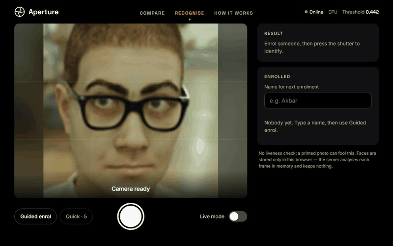
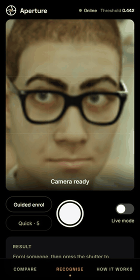
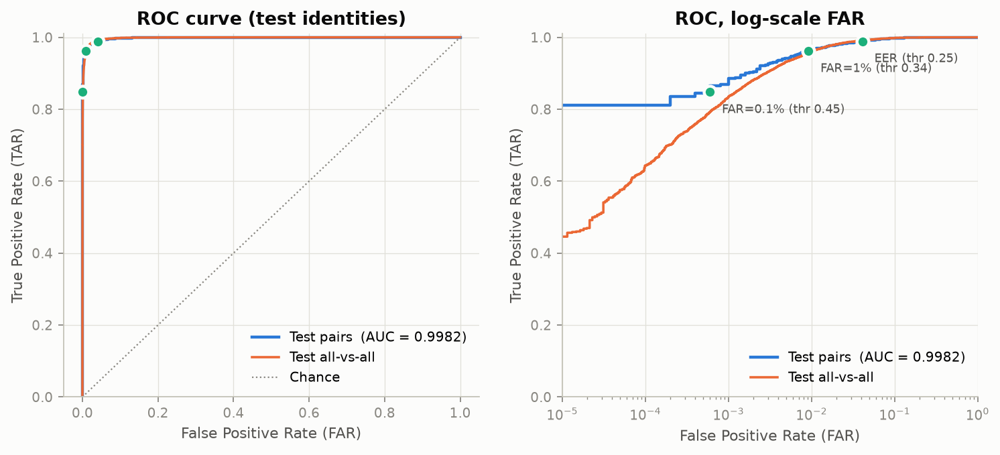
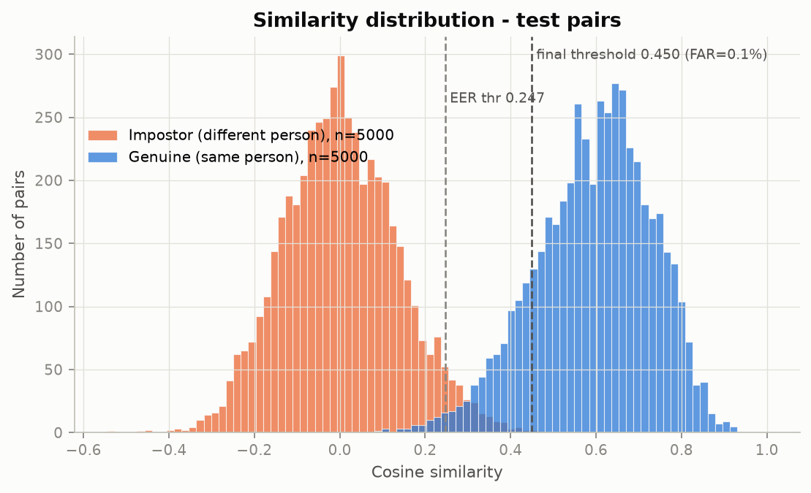
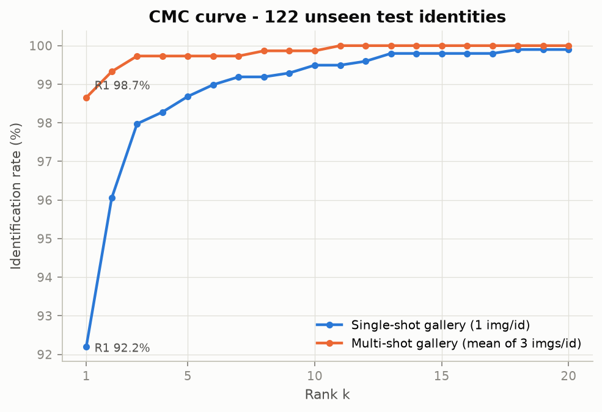

# Face Verification & Re-Identification with a ResNet Embedding Model

This project answers two questions:

* **Verification (1:1):** are these two face images the same person?
* **Identification (1:N):** which enrolled person is this?

It uses a ResNet50 that I fine-tuned to output 512-D L2-normalised embeddings, compared with cosine similarity. The same model, distilled to a small INT8 ResNet18, powers **Aperture**, a web app that runs on a plain CPU and works on desktop and phone.

## Try Aperture

**Live demo: https://aperture-face.vercel.app** (the camera asks for permission; the server keeps nothing, enrolled faces stay in your browser).

<p align="center">
  
  &nbsp;
  
</p>

*Guided enrolment works like phone Face ID setup: look straight, then turn left, right, up and down; each step is confirmed from the face landmarks before a shot is kept. The GIFs are real runs of the app, but the camera in them is a pre-made clip of a **synthetic** face (DigiFace-1M), because a recording needs someone to turn their head. The clip cross-fades between poses, which is the ghosting you see, and the last step (Down) was skipped with the Skip button. Tested on real head movement: not yet.*

### Run it on your own machine (pick one, about a minute)

| You have | Run | Then open |
|---|---|---|
| **Windows** + Python 3.11+ | `.\run_app.ps1` | http://localhost:8000 (opens by itself) |
| **macOS / Linux** + Python 3.11+ | `./run_app.sh` | http://localhost:8000 (opens by itself) |
| **Docker** (no clone, no Python) | `docker run -p 8000:8000 akbardebug/aperture-face` | http://localhost:8000 |
| **Docker** (build from this repo) | `docker compose up --build` | http://localhost:8000 |

If Windows says *"running scripts is disabled on this system"*, run `powershell -ExecutionPolicy Bypass -File .\run_app.ps1` instead (this changes nothing permanently). Add `-NoBrowser` (or `NO_BROWSER=1` on macOS/Linux) to skip opening the browser.

The Python launchers create their own virtual environment (`.venv-app`), install 6 small packages from [`requirements-app.txt`](requirements-app.txt) (no PyTorch, no GPU) and start the app. The model it serves ships in this repo (`checkpoints/face_r18_int8.onnx`, 24 MB). Browsers only allow the camera on `https://` or `localhost`, so use `localhost` rather than your PC's network address. To put it online for free, see [`deploy/README.md`](deploy/README.md).

Everything below is the full assessment write-up: data, training, evaluation, edge deployment.

Every number in this README is read from [`results/evaluation_results.json`](results/evaluation_results.json), [`results/ablation.csv`](results/ablation.csv) or [`results/edge_benchmark.csv`](results/edge_benchmark.csv), all produced by the scripts below. [`report.pdf`](report.pdf) is generated from the same files.

## Results at a glance

Measured on the **122 held-out test identities**, which were never used for training, epoch selection or threshold selection.

| Metric | Result |
|---|---|
| ROC-AUC (5,000 genuine + 5,000 impostor pairs) | **0.9982** (95% bootstrap CI 0.9978–0.9986) |
| EER | **2.04%** (CI 1.78%–2.34%) |
| TAR @ FAR = 1% | **96.42%** |
| TAR @ FAR = 0.1% (all-vs-all, 607,548 impostor scores) | **83.36%** |
| **Final cosine threshold** | **0.4499**: `cosine >= 0.4499` → Match (picked on validation identities at FAR = 0.1%) |
| Rank-1 / Rank-5 (1 enrolled image per identity, 122 identities) | **92.21%** / 98.68% |
| Rank-1 (gallery template = mean of 3 images) | **98.66%** |
| Edge model: ResNet18 INT8 | 24 MB, 3.4 ms per face on one desktop-CPU thread, TAR@FAR=1% 90.6% |

Figures: [`roc_curve.png`](results/roc_curve.png), [`similarity_distribution.png`](results/similarity_distribution.png), [`cmc_curve.png`](results/cmc_curve.png), [`far_frr_vs_threshold.png`](results/far_frr_vs_threshold.png), [`error_cases.png`](results/error_cases.png).
Latencies were measured on a desktop CPU and GPU, **not** on real edge hardware (see section 13).


---

## 1. Dataset: source, licence, size

| | LFW: real faces | DigiFace-1M: synthetic faces |
|---|---|---|
| Role | fine-tuning (train ids), model and threshold selection (val ids), **all reported results (test ids)** | stage-1 training, together with the LFW *train* identities |
| Source | UMass Amherst, http://vis-www.cs.umass.edu/lfw/ | Microsoft, https://github.com/microsoft/DigiFace1M (WACV 2023) |
| Usage conditions | public research benchmark of news photos of public figures; no formal licence, cite the authors; used for non-commercial research | *Research Use of Data Agreement v1.0*: **non-commercial research only** |
| Used here | identities with ≥ 4 images: **610 identities, 6,733 images** | 10,000 identities × 72 = **720,000 images** (fully synthetic, no real person) |

No data was scraped by me, and there are no mugshots or criminal-record data. Full details are in [`docs/DATASHEET.md`](docs/DATASHEET.md).

**Pre-processing** ([`dataset_preparation.py`](dataset_preparation.py), [`common/align.py`](common/align.py)):
1. **Detection:** YuNet (OpenCV Zoo, Apache-2.0) finds faces and 5 landmarks. When a photo has several faces, the subject is the large face closest to the centre. All 6,733 / 6,733 images were detected.
2. **Alignment:** my own Umeyama least-squares *similarity transform* maps the 5 landmarks onto the standard 112×112 ArcFace template. Eyes, nose and mouth always land on the same pixels.
3. **Crop and resize** to 112×112, saved as `data/processed/lfw_aligned/person_001/img_01.jpg` (the layout requested in the brief), with `lfw_meta.csv` mapping back to original names.
4. **Normalisation:** RGB scaled to [-1, 1], identical at training, evaluation, ONNX, API and demo time.

**Split: identity-disjoint, seed 42** (test identities are never seen in training):

| Split | Identities | Images used | Used for |
|---|---|---|---|
| train | 427 | 4,891 | fine-tuning, INT8 calibration, distillation |
| val | 61 | 378 | choosing the best epoch, choosing the threshold |
| test | 122 | 1,110 of 1,464 (capped at 30 / identity) | every reported metric |

**Duplicate and leakage control.** LFW contains some photos twice. A perceptual hash (pHash) of the *full original photo* proposes candidate pairs (Hamming distance ≤ 8). A pixel-correlation check (≥ 0.93) then confirms them. This found **10 duplicate pairs**, all within one identity. Duplicates are kept in one split and are never used as a positive pair. I first tried hashing the *aligned* crops, but aligned faces all share the same layout, so the hash matched different people (e.g. Schwarzenegger vs. Elizabeth Dole). I checked that by eye and rejected the approach. [`tests/test_splits.py`](tests/test_splits.py) asserts zero identity overlap and zero duplicate leakage.

## 2. Installation

```bash
python -m venv .venv && .venv\Scripts\activate          # Windows  (Linux: source .venv/bin/activate)
pip install -r requirements.txt                         # PyTorch 2.11 + CUDA 12.8 (RTX 50-series ready)
pip install -r requirements-edge.txt                    # optional: TensorRT FP16 engine
```
Data goes to `../data` by default (override with `FACE_DATA`). `run_all` downloads LFW (~180 MB), YuNet (~230 KB) and five DigiFace-1M parts (~14.7 GB, 10,000 identities).

## 3. Training command

```bash
python dataset_preparation.py                                   # Task 1
python generate_pairs.py                                        # Task 3 (val + test pairs)
python train.py --config configs/pretrain_digiface.yaml         # stage 1: 10k synthetic + LFW-train identities
python train.py --config configs/finetune_lfw.yaml              # stage 2: LFW train ids -> checkpoints/best_model.pth
```

## 4. Evaluation command

```bash
python evaluate_pairs.py                  # Task 4: embeddings + cosine similarity for every pair
python roc_analysis.py                    # Tasks 6-7: ROC/AUC, EER, TAR@FAR, threshold (chosen on val)
python gallery_probe.py                   # Task 5: Rank-1/5/10, CMC, open-set, mAP
python -m analysis.ablation               # ablation table
python -m analysis.error_analysis ; python -m analysis.gradcam
python -m pytest tests -q                 # leakage / pair / metric / model / ONNX-parity tests
python -m analysis.make_report            # report.pdf
```
Or run everything at once: `.\run_all.ps1` (Windows) / `bash run_all.sh`. A minutes-long smoke test is `--quick` / `-Quick`. **Warning:** quick mode writes to the same `checkpoints/` and `results/` folders, so run it in a fresh copy of the project, never on top of finished results. Each stage was run and checked individually; `run_all` chains the same commands, but I did not execute the whole chain in one go.

## 5. Model architecture ([`model.py`](model.py))

```
aligned face 3x112x112
  -> ResNet50 body (torchvision, ImageNet init; stem max-pool removed so layer4 = 7x7 instead of 4x4)
  -> 1x1 conv 2048->512 + BN + PReLU
  -> BN -> Dropout(0.4) -> Flatten (512*7*7)          "output layer E" style head: keeps spatial layout
  -> FC -> 512 -> BN
  -> L2 normalisation  ==> 512-D unit-length embedding  (37.4 M parameters)
```
`FaceEmbedder.forward()` returns **only the normalised embedding**. Identity classifiers live in [`common/losses.py`](common/losses.py) and are thrown away after training, so cosine similarity can never be computed on logits.

## 6. Training methodology and why

* **Loss: ArcFace + 0.1 × batch-hard triplet** (the "combination of classification and metric learning" option).
  * *ArcFace* (additive angular margin, s·cos(θ+m)) is identity classification with cross-entropy, but it is computed on the angle between the unit embedding and each class centre. That is exactly the geometry cosine verification uses at test time. The margin forces each identity into a tight cone, well apart from the others. It needs no pair mining, and it scales to thousands of identities.
  * The *batch-hard triplet* term adds an explicit relative constraint on the hardest positive and negative in every batch, which sharpens the decision boundary near the threshold.
  * Triplet training alone needs careful mining, and plain softmax gives separable classes without an explicit margin. The ablation below measures these choices; the evidence for ArcFace over softmax is modest (see below), so I do not oversell it.
* **Two stages.** LFW alone has only 427 training identities, and most have 4–6 images, so a ResNet50 overfits quickly (the ablation shows LFW-only training reaches only about 54–68% TAR@FAR=1%). **Stage 1** trains jointly on **10,000 synthetic DigiFace identities (720k images, no privacy cost)** and the 427 real LFW *training* identities as extra classes; the real faces anchor the features to real photographs. **Stage 2** fine-tunes on the LFW training identities alone. A first attempt that used only 4,000 synthetic identities overfit them (details in the ablation).
* **Batches:** P×K identity-balanced sampling (64×4 in stage 1, 32×4 in stage 2). One person with 530 photos cannot dominate, and every batch contains positives for the triplet term.
* **Optimisation:** SGD with Nesterov momentum, warm-up then cosine learning-rate decay, bf16 mixed precision, channels-last memory layout, gradient clipping, margin warm-up. In stage 2 the backbone LR is ×0.1, the new ArcFace head LR is ×10, and BatchNorm is frozen for epoch 1.
* **Augmentation:** horizontal flip, mild random-resized crop, colour jitter, greyscale, blur, random down-scaling (low-res cameras) and random erasing (occlusions).
* **Model selection:** after every epoch I measure TAR@FAR=1% on *all* validation pairs; the best epoch is kept. Test identities are never loaded during training.

### Ablation: what actually mattered

Every row is scored the same way. Model-selection decisions used the **val** columns. Test columns are shown for completeness (TAR = TAR@FAR=1%, Rank-1 = single-shot gallery). Source: [`results/ablation.csv`](results/ablation.csv), produced by `python -m analysis.ablation`.

| Variant | val AUC | val TAR | test AUC | test EER | test TAR | Rank-1 |
|---|---|---|---|---|---|---|
| ImageNet ResNet50, GAP features, no face training | 0.7183 | 10.4% | 0.7524 | 31.76% | 11.2% | 16.8% |
| LFW only: softmax cross-entropy | 0.9519 | 53.0% | 0.9641 | 10.04% | 60.0% | 57.0% |
| LFW only: batch-hard triplet | 0.9362 | 47.1% | 0.9545 | 11.62% | 53.6% | 48.5% |
| LFW only: ArcFace | 0.9450 | 54.5% | 0.9657 | 10.00% | 68.2% | 59.1% |
| LFW only: ArcFace + 0.1 triplet | 0.9286 | 52.5% | 0.9685 | 9.46% | 67.4% | 60.6% |
| v1: 4k synthetic ids only (no real faces in stage 1) + LFW fine-tune | 0.9816 | 82.3% | 0.9950 | 3.34% | 92.0% | 85.4% |
| Stage 1 only: 10k synthetic ids + LFW-train ids jointly, no stage-2 fine-tune | 0.9874 | 86.4% | 0.9973 | 2.44% | 95.4% | 91.6% |
| Stage 1 + stage-2 LFW fine-tune, no flip-TTA | 0.9883 | 86.7% | 0.9977 | 2.44% | 95.5% | 90.6% |
| Stage 1 + stage-2 LFW fine-tune, flip-TTA (submission) | 0.9897 | 88.4% | 0.9982 | 2.04% | 96.4% | 92.2% |

The *v1* row comes from the earlier recipe (`dataset: digiface`, `digiface_max_ids: 4000`, a 16-epoch schedule, then the same stage 2). Its checkpoint is archived as `checkpoints/v1_best_model.pth` and is not rebuilt by `run_all`; on a fresh run that row is skipped.

What this does and does not show:
* **Pre-training on many identities is the dominant factor.** LFW-only training reaches about 54–68% TAR@FAR=1%. Adding 10,000 synthetic identities lifts it to about 95%. A ResNet50 cannot learn a good face embedding from 427 identities.
* **The loss choice is a smaller, less certain effect.** Among the four LFW-only runs, the ArcFace variants are ahead on the *test* columns, but plain softmax has the best *validation* AUC. The differences between the three classification-style losses are small and mixed (on validation, ArcFace + triplet actually has the *lowest* AUC of the four LFW-only runs, 0.9286), and each variant is a single run, so I cannot call this a clear win for ArcFace. The recipe was fixed before the ablation was run, because ArcFace is the standard, well-founded choice for cosine matching; the ablation did not overturn that choice, but it does not strongly confirm it either. The LFW-only runs also used a shorter, untuned schedule.
* **Synthetic-only pre-training overfit.** The first stage 1 (4,000 synthetic identities, row v1) reached 99% synthetic training accuracy while real-face validation peaked at epoch 5. Using all 10,000 identities and adding the real LFW *train* identities to stage 1 fixed it (v1 → stage 1: test TAR 92.0% → 95.4%).
* **Stage-2 fine-tuning and flip-TTA each help by roughly 1 point of TAR@FAR=1%, but the gains overlap** rather than add up. Fine-tuning: 95.4% → 96.4% (both with flip-TTA). Flip-TTA on the fine-tuned model: 95.5% → 96.4%. The fine-tuning gain is clearer on validation (86.4% → 88.4%).


## 7. Positive / negative pair generation ([`generate_pairs.py`](generate_pairs.py))

* **Positives (label 1):** two different images of one identity. The pool is every combination C(nᵢ, 2). Each identity gets a quota proportional to √(pool size), capped at the pool size, with any leftover redistributed. Large identities contribute more pairs but cannot dominate (max 191 of 5,000).
* **Negatives (label 0):** pick an identity pair uniformly, then one image from each. The impostor set is identity-balanced and has the same size as the positive set.
* **No duplicates:** every pair is stored in canonical order `(min(path), max(path))` in a set, so it can't repeat or appear mirrored as (b, a). Self-pairs are impossible. Near-duplicate photos are never paired.
* **No leakage:** pairs are built only from the images of one split. `tests/test_pairs.py` asserts that no pair contains a training image, that there are no duplicate pairs, and that labels are exactly 50/50.
* **Result:** **test 5,000 + 5,000** pairs from 122 unseen identities; val 1,477 + 1,477 (the most the 61 val identities allow). For thresholds and low-FAR estimates I also score **all-vs-all** pairs (test: 7,945 genuine / 607,548 impostor), so FAR=0.1% is measured from ~600 false accepts, not 5.

## 8. Gallery / Probe methodology ([`gallery_probe.py`](gallery_probe.py))

* **Single-shot (primary):** the gallery holds 1 seeded image per test identity (122 identities). Every other image is a probe. Each probe is assigned the gallery identity with the highest cosine similarity.
* **Multi-shot:** the gallery template is the mean of 3 embeddings, re-normalised. This mirrors real enrolment with several photos.
* **Open-set:** 20% of test identities are *not* enrolled and must be rejected. DIR@FAR is the share of known probes identified correctly at rank 1 *and* above a threshold that accepts only FAR of the unknown probes.
* **Retrieval mAP:** every test image queries every other one (Re-ID style).
* Per-probe output, with top-5 candidates and scores, is in [`results/gallery_probe_results.csv`](results/gallery_probe_results.csv). The CMC curve is in [`results/cmc_curve.png`](results/cmc_curve.png).

## 9. Final cosine threshold

```
Threshold = 0.4499
cosine >= 0.4499  ->  Match
cosine <  0.4499  ->  Non-Match
```

**How it was chosen (no test tuning).** Candidate thresholds were computed on the **validation identities** only, from all-vs-all scores (69,776 impostor and 1,477 genuine validation pairs). They were then applied *unchanged* to the test pairs:

| Operating point (threshold fixed on val) | Threshold | TAR | FAR | Precision | Recall | F1 | Accuracy |
|---|---|---|---|---|---|---|---|
| EER | 0.2474 | 98.90% | 4.100% | 0.9602 | 0.9890 | 0.9744 | 0.9740 |
| FAR = 1% | 0.3359 | 96.16% | 0.920% | 0.9905 | 0.9616 | 0.9758 | 0.9762 |
| **FAR = 0.1% (final)** | 0.4499 | 84.76% | 0.060% | 0.9993 | 0.8476 | 0.9172 | 0.9235 |
| max-F1 | 0.2491 | 98.84% | 3.960% | 0.9615 | 0.9884 | 0.9748 | 0.9744 |

* The final operating point is **FAR = 0.1%**: a false accept (letting the wrong person in) is the costly error in verification, so the threshold is set from a target false-accept rate. On test it gives FAR = 0.060% (the 3 false accepts among 5,000 impostor pairs) and rejects 15.2% of genuine pairs.
* For a convenience use case where a false reject is more annoying, use the EER threshold (0.2474) or the max-F1 threshold (0.2491): 98.9% TAR at 4.1% FAR.
* The ResNet18 INT8 edge model has its own score distribution, so it gets its own validation-calibrated threshold at the same FAR: **0.4423** (test TAR 77.0%, FAR 0.16%).
* A threshold calibrated on LFW must be re-calibrated on the target camera before real use.

## 10. ROC-AUC result

ROC curves are built with scikit-learn's `roc_curve` on the **actual cosine scores** of the test pairs ([`roc_analysis.py`](roc_analysis.py)); nothing is simulated.

| Threshold-free metric (test) | Pairs (5,000 + 5,000) | All-vs-all (7,945 genuine / 607,548 impostor) |
|---|---|---|
| **AUC** | **0.9982** (CI 0.9978–0.9986) | 0.9982 |
| EER | 2.04% (CI 1.78%–2.34%) | 1.96% |
| TAR @ FAR = 1% | 96.42% | 96.07% |
| TAR @ FAR = 0.1% | 88.56% (only 5 false accepts at this level, so noisy) | 83.36% |
| TAR @ FAR = 0.01% | not measurable with 5,000 impostors | 64.29% |

Mean cosine similarity: genuine 0.595 ± 0.136, impostor 0.003 ± 0.134. Cosine is computed on the L2-normalised **embeddings**, never on classifier logits.




**How the threshold trades false accepts against false rejects** ([`far_frr_vs_threshold.png`](results/far_frr_vs_threshold.png)):
* **Raising** the threshold makes the system stricter. Fewer impostors score above it, so **false accepts fall**, but more genuine pairs fall below it, so **false rejects rise**.
* **Lowering** it does the opposite: more genuine users are accepted, but more impostors are accepted too.
* The ROC curve is this trade-off traced over every threshold. A better model pushes the whole curve toward the top-left. The EER is the point where the two error rates are equal.
* On the test pairs the genuine mean is 0.59 and the impostor mean 0.00, but the tails overlap between about 0.25 and 0.45. That overlap is where the choice of threshold decides which error you get.

*Note on the confidence intervals:* the bootstrap resamples pairs as if they were independent, but pairs share images and identities. The intervals therefore understate the real uncertainty.

## 11. Rank-1 accuracy

| Protocol (122 unseen test identities) | Probes | Rank-1 | Rank-5 | Rank-10 |
|---|---|---|---|---|
| Single-shot gallery (1 image / identity) | 988 | **92.21%** | 98.68% | 99.49% |
| Multi-shot gallery (mean of 3 images / identity) | 744 | **98.66%** | 99.73% | 99.87% |

* **Open-set** (98 enrolled, 24 unknown identities that must be rejected): DIR@FAR=1% **64.5%**, @5% 81.4%, @10% 85.0%.
* **Retrieval mAP** (every test image queries every other): 0.9374.
* Rank-1 is closed-set: it assumes the person is enrolled. Averaging several enrolment images raises Rank-1 from 92.2% to 98.7%, so enrolment quality matters more than almost any model change.
* A 122-identity gallery is small, so these Rank-1 numbers will not carry over to a gallery of thousands.



## 12. Known limitations

* **Population bias.** LFW is news photography of public figures, mostly adult, light-skinned and male, in good light. I did not measure error rates per demographic group, and they are likely worse for under-represented groups. DigiFace is more varied, but synthetic.
* **Small test set.** There are 122 test identities. LFW is also close to saturated for strong models, so these numbers are a sanity check, not a production benchmark. The bootstrap CIs treat pairs as independent and so are optimistic (see section 10).
* **How the test set was used.** The test split was never used to pick epochs, thresholds or hyper-parameters. I did, however, evaluate the first pre-training recipe (v1) on test before deciding to rebuild stage 1 (v2, more identities plus LFW-train identities). That decision was mainly driven by the validation curve (overfitting by epoch 5–8), but I had seen v1's test numbers, so the reported test numbers carry a small optimistic selection effect. Each ablation variant is a single run, with no seed repeats.
* **No liveness or anti-spoofing.** A printed photo or a screen replay would be scored like a live face. A real access-control deployment needs presentation-attack detection in front of this model.
* **Licence.** DigiFace-1M is non-commercial, so these weights are for research and demonstration only. A commercial version would need commercially licensed or consented training data.
* **Detector failure modes.** YuNet can miss strong profiles and very small faces, and alignment quality bounds recognition quality. The worst genuine pairs in [`error_cases.png`](results/error_cases.png) involve sunglasses, helmets or caps, strong blur and extreme expression or pose.
* **Thresholds are domain-specific.** A threshold calibrated on LFW must be re-calibrated on data from the target camera before deployment. At the final threshold, 15.2% of genuine test pairs are rejected.
* **Edge numbers are proxies.** Latency was measured on an AMD Ryzen 9 9950X desktop and an RTX 5080, not on a Raspberry Pi or a Jetson (see section 13).
* **Biometric data.** Embeddings are personal data. The API stores embeddings only (never images) and supports deletion, but deployment still needs consent and a lawful basis.

## 13. Edge deployment (extra, beyond the brief)

The brief asks for a ResNet model; the company also asked about edge-device experience, so the ResNet is compressed and benchmarked for small devices.

1. **Distillation:** a ResNet18 student learns from the ResNet50 teacher (cosine loss on the embeddings plus a loss on the in-batch similarity matrix), using training identities only (`python -m edge.distill`).
2. **ONNX export** with a parity check against PyTorch (min cosine 0.9999999); `python -m edge.export_onnx`.
3. **Static INT8 quantisation** with ONNX Runtime (per-channel INT8 weights, UINT8 activations, calibrated on 512 *training* images; `python -m edge.quantize_int8`). U8S8 was chosen after measuring it: it ran about 3× faster than FP32 on this CPU, while the signed S8S8 variant gave only about 1.3×. This is hardware-dependent, so re-measure on the target device.
4. **TensorRT FP16** engine (`python -m edge.build_tensorrt`). TensorRT 11 builds strongly-typed networks, so the ONNX graph is converted to FP16 first; on older TensorRT (e.g. JetPack 6) the classic FP16 flag is used.

Same 5,000 + 5,000 test pairs, single forward pass, no flip-TTA. Source: [`results/edge_benchmark.csv`](results/edge_benchmark.csv).

| Model | Runtime | Precision | Device | Size (MB) | Latency p50 (ms, batch 1) | Test AUC | TAR@FAR=1% |
|---|---|---|---|---|---|---|---|
| R50 | PyTorch | FP32 | GPU | 149.6 | 6.02 | 0.9978 | 95.4% |
| R50 | ONNX Runtime | FP32 | CPU (1 thread) | 149.6 | 27.76 | 0.9978 | 95.4% |
| R50 | ONNX Runtime | FP32 | CPU (4 threads) | 149.6 | 8.41 | 0.9978 | 95.4% |
| R50 | ONNX Runtime CUDA | FP32 | GPU | 149.6 | 1.96 | 0.9978 | 95.4% |
| R50 | ONNX Runtime | INT8 | CPU (1 thread) | 38.0 | 8.05 | 0.9978 | 95.8% |
| R50 | ONNX Runtime | INT8 | CPU (4 threads) | 38.0 | 3.04 | 0.9978 | 95.8% |
| R18 | PyTorch | FP32 | GPU | 96.0 | 2.67 | 0.9945 | 90.8% |
| R18 | ONNX Runtime | FP32 | CPU (1 thread) | 96.1 | 12.50 | 0.9945 | 90.8% |
| R18 | ONNX Runtime | FP32 | CPU (4 threads) | 96.1 | 4.09 | 0.9945 | 90.8% |
| R18 | ONNX Runtime CUDA | FP32 | GPU | 96.1 | 1.12 | 0.9945 | 90.8% |
| R18 | ONNX Runtime | INT8 | CPU (1 thread) | 24.2 | 3.41 | 0.9944 | 90.6% |
| R18 | ONNX Runtime | INT8 | CPU (4 threads) | 24.2 | 1.10 | 0.9944 | 90.6% |
| R18 | TensorRT 11.5.0.63 | FP16 | GPU | 48.5 | 0.35 | 0.9945 | 90.8% |
| R50 | TensorRT 11.5.0.63 | FP16 | GPU | 75.5 | 0.63 | 0.9978 | 95.3% |

* **Accuracy cost.** ResNet50 INT8 matches FP32 (parity cosine 1.000→0.998). The distilled ResNet18 INT8 loses about 4.9 points of TAR@FAR=1% against the ResNet50 FP32 (90.6% vs 95.4%) and is about 6× smaller and 8× faster than it (1 CPU thread).
* **Full pipeline** (YuNet detection + alignment + embedding, ResNet18 INT8, 4 CPU threads, 250×250 photos): **3.16 ms per face**, roughly 316 FPS.
* **These are not Raspberry Pi or Jetson numbers.** Everything was measured on an AMD Ryzen 9 9950X and an RTX 5080. Restricting the CPU to 1 thread only loosely approximates a small board: a Raspberry Pi 5 or a Jetson CPU would be several times slower. Use the table for *relative* comparisons (size, speed-up, accuracy cost). The ONNX files and the Docker image are the artefacts to benchmark on real hardware.
* **Serving.** [`api/app.py`](api/app.py) is a FastAPI service on ONNX Runtime only (no PyTorch): `POST /verify`, `/enroll`, `/identify`, `DELETE /enroll/{name}`. It stores embeddings only, never images. `uvicorn api.app:app --port 8000` runs it locally and serves a small web page at `/` (webcam enrol / identify / verify). The page has a Face-ID-style *guided enrolment*: it asks you to look straight, turn left, turn right, tilt up and tilt down, and only keeps a shot once `POST /pose` (head-pose cues from the 5 YuNet landmarks, relative to your own frontal baseline) confirms the movement. The page keeps enrolled embeddings in the visitor's browser and calls `POST /analyze` (detection + pose + embedding in one round trip), so the same page also runs on a **stateless serverless deployment** ([`deploy/`](deploy/README.md), Vercel-ready). The pose cues are a cheap geometric estimate, not a calibrated head-pose model. I tested the page end to end in real Chrome with a fake camera playing a looping photo (enrol, identify, live mode, the guided flow up to its first turn prompt, photo comparison, persistence across restarts, delete, a stranger rejected), both against the normal server and against the deployment folder in a clean virtual environment. The head-turn steps themselves have never been run with a real moving head, the deployment has not yet been run on Vercel, and the Docker image was not rebuilt after the web page was added. I built the image and exercised every endpoint on raw LFW photos inside the container (smoke test, not an evaluation): an unrelated pair was rejected, an enrolled person was identified correctly, an unseen person came back `unknown`, and an undecodable file returned HTTP 400. One same-person pair I tried (Tony Blair, two photos) was *rejected* (cosine 0.31 < 0.44): it is one of that identity's hardest pairs and illustrates the false-reject cost of the strict FAR = 0.1% threshold, not a pipeline bug (the API's crops match the dataset crops to within JPEG re-encoding noise). [`api/Dockerfile`](api/Dockerfile) builds a CPU image (python-slim, opencv-headless, onnxruntime).
* **Live demo.** `python -m demo.webcam_demo --enroll "YourName"` enrols from the camera, then `python -m demo.webcam_demo` runs live identification with an FPS overlay. I tested the enrol and identify logic headlessly on a video file (`--camera clip.mp4 --headless`): it enrolled a held-out test identity from 8 frames, recognised that person's other photos (cosine 0.65–0.81) and labelled a different person `unknown`. I did **not** test it with a live camera or the on-screen window.


## 14. Project structure

```
submission/
├── README.md  requirements.txt  requirements-edge.txt  run_all.ps1  run_all.sh  report.pdf
├── run_app.ps1  run_app.sh  requirements-app.txt  docker-compose.yml        (one-command app launchers)
├── dataset_preparation.py  train.py  model.py  generate_pairs.py        (required scripts)
├── evaluate_pairs.py  gallery_probe.py  roc_analysis.py
├── configs/      pretrain_digiface.yaml  finetune_lfw.yaml  distill_r18.yaml
├── common/       align.py (detection + own similarity alignment)  data.py  losses.py  metrics.py
│                 embed.py  onnx_runtime.py  plotting.py  io.py  seed.py
├── analysis/     ablation.py  error_analysis.py  gradcam.py  make_report.py
├── edge/         distill.py  export_onnx.py  quantize_int8.py  build_tensorrt.py  benchmark_edge.py
├── api/          app.py (FastAPI)  engine.py  Dockerfile  static/ (web page)
├── deploy/       build_vercel.py  vercel/ (stateless serverless app)  README.md (hosting guide)
├── demo/         webcam_demo.py
├── tests/        test_splits.py  test_pairs.py  test_metrics.py  test_model.py  test_onnx_parity.py  test_engine.py
├── docs/         DATASHEET.md  MODEL_CARD.md  media/ (README GIFs)
├── checkpoints/  best_model.pth  r18_student.pth  *_int8.onnx  YuNet   (see the note below)
└── results/      roc_curve.png  similarity_distribution.png  evaluation_results.json  gallery_probe_results.csv
                  cmc_curve.png  far_frr_vs_threshold.png  det_curve.png  ablation.csv  edge_benchmark.csv
                  error_cases.png  gradcam.png  pairs/  train_logs/
```

**Not in this repository** (GitHub rejects files over 100 MB, and these can be rebuilt): the FP32 ONNX exports `face_r50.onnx` and `face_r18.onnx` (`python -m edge.export_onnx`), the FP16 ONNX/TensorRT engines (`edge/build_tensorrt.py`), the ablation checkpoints `ablation_*.pth`, the stage-1 checkpoint `r50_digiface.pth`, the earlier-recipe `v1_*.pth` files, and the datasets (`run_all` downloads them). The numbers for those variants are still in `results/*.csv` and `results/evaluation_results.json`; only re-running the edge benchmark or the ablation needs the missing files.

## 15. Related work by the author

I also built **securengo-face**, a separate production face-recognition system that does not use ResNet: https://github.com/AkbarSheikh-debug/securengo-face. This assessment deliberately follows the brief's ResNet-based design and does not reuse any of its code. The edge work in section 13 shows the same deployment concerns (quantisation, latency budgets, CPU-only serving) applied to this ResNet model.
